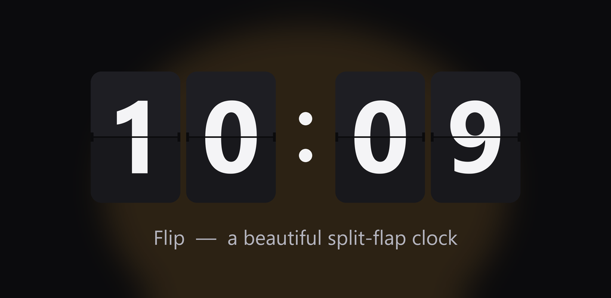

# Flip

A split-flap flip clock for Android, with a timer, a stopwatch, home-screen widgets and a
screen saver. Kotlin + Jetpack Compose. No ads, no tracking, no permissions.



## Features

- **Clock**: realistic flip animation (shading, seam, bounce), 11 themes including
  Material You, 6 fonts, 3 card shapes, adjustable size, seconds, date in 7 styles,
  next alarm, battery.
- **Timer**: presets plus up/down arrows on each digit group, an "ends at" time, a progress
  bar, +1:00, and a looping chime when time is up.
- **Stopwatch**: hundredths, laps with the best lap highlighted.
- **Navigation**: tap for the floating mode switcher and settings, swipe left or right
  between Clock, Timer and Stopwatch, long-press the launcher icon for shortcuts.
- **Nightstand**: keep the screen on, dim when idle, red night mode, burn-in shift,
  immersive fullscreen, Android screen saver.
- **Widgets**: Flip Clock, Flip Clock & Date, Flip Calendar, Flip Mini, each with 13
  themes. They use `TextClock`, so they are always accurate and cost no battery.

## Build

Requires JDK 17 and the Android SDK (compileSdk 36).

```sh
./gradlew :app:assembleDebug           # debug APK
./gradlew :app:testDebugUnitTest       # unit tests
./gradlew :app:lintRelease             # lint (aborts on errors)
./gradlew :app:bundleRelease           # Play bundle (signed if keystore.properties exists)
```

Render screenshots of the real app without a device (Robolectric, output in `store/screens/`):

```sh
./gradlew :app:testDebugUnitTest -Pscreenshots --tests "*ScreenshotTest*"
```

Release signing reads a git-ignored `keystore.properties` in the repo root
(`storeFile`, `storePassword`, `keyAlias`, `keyPassword`).

## Project notes

See [SESSIONS.md](SESSIONS.md) for architecture, design decisions and the work log, and
[PRIVACY.md](PRIVACY.md) for the privacy policy.
